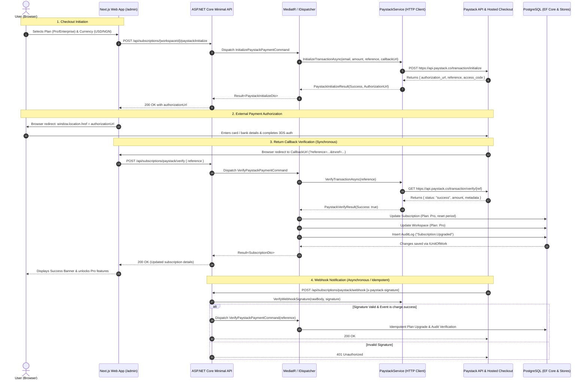

# IntelliQueryAI — Paystack Payment Gateway Integration Guide

This document details the end-to-end implementation of the **Paystack Payment Gateway** integration within the IntelliQueryAI platform. It covers architectural design, backend CQRS commands, HTTP client integration, webhook signature validation, frontend checkout redirection, and database persistence.

---

## 1. Architectural Architecture & Workflow

IntelliQueryAI uses **Clean Architecture** and **CQRS (Command Query Responsibility Segregation)** with a secure hosted redirection checkout flow.



---

## 2. Configuration & Secrets

Configuration is managed via `appsettings.json` (and overridden by environment variables in production).

### Configuration Schema (`src/IntelliQueryAI.Infrastructure/Services/Paystack/PaystackOptions.cs`)

```csharp
public sealed class PaystackOptions
{
    public const string SectionName = "Paystack";

    public string SecretKey { get; set; } = string.Empty;
    public string PublicKey { get; set; } = string.Empty;
    public string Currency { get; set; } = "USD";
    public string CallbackUrl { get; set; } = "http://localhost:3000/admin";
}
```

### `appsettings.json` Configuration

```json
{
  "Paystack": {
    "SecretKey": "sk_test_a7aa8f921ef561272720890e62eecfe3914dc571",
    "PublicKey": "pk_test_1680c08b7b51fb92fec7eab72d30249125e915ec",
    "Currency": "USD",
    "CallbackUrl": "http://localhost:3000/admin"
  }
}
```

> **Production Note:** In production, store `SecretKey` and `PublicKey` as environment variables:
> - `Paystack__SecretKey`
> - `Paystack__PublicKey`
> - `Paystack__CallbackUrl`

---

## 3. Backend Implementation

### A. HTTP Service Contract & Implementation

#### Service Abstraction (`src/IntelliQueryAI.Application/Abstractions/Services/IPaystackService.cs`)

Defines strongly-typed request and response records decoupled from the HTTP transport layer:

```csharp
public sealed record PaystackInitializeRequest(
    string Email,
    int AmountInSubunits,
    string Currency,
    string Reference,
    string CallbackUrl,
    IReadOnlyDictionary<string, string> Metadata);

public sealed record PaystackInitializeResult(
    bool Success,
    string? AuthorizationUrl,
    string? AccessCode,
    string? Reference,
    string? Message);

public sealed record PaystackVerifyResult(
    bool Success,
    string Status,
    string Reference,
    int Amount,
    string Currency,
    string? GatewayResponse,
    IReadOnlyDictionary<string, string> Metadata,
    string? Message);

public interface IPaystackService
{
    string PublicKey { get; }
    Task<PaystackInitializeResult> InitializeTransactionAsync(PaystackInitializeRequest request, CancellationToken cancellationToken = default);
    Task<PaystackVerifyResult> VerifyTransactionAsync(string reference, CancellationToken cancellationToken = default);
    bool VerifyWebhookSignature(string requestBody, string signature);
}
```

#### Service Implementation (`src/IntelliQueryAI.Infrastructure/Services/Paystack/PaystackService.cs`)

Directly talks to the official Paystack REST API (`https://api.paystack.co/`):
- **Authorization:** `Bearer {SecretKey}` added to default request headers.
- **Amounts:** Amounts are converted into smallest currency subunits (cents for USD, kobo for NGN).
- **Error Handling:** Parses JSON error responses from Paystack or provides descriptive fallback messages.

```csharp
public async Task<PaystackInitializeResult> InitializeTransactionAsync(
    PaystackInitializeRequest request,
    CancellationToken cancellationToken = default)
{
    var payload = new
    {
        email = request.Email,
        amount = request.AmountInSubunits,
        currency = request.Currency,
        reference = request.Reference,
        callback_url = request.CallbackUrl,
        metadata = request.Metadata
    };

    var jsonContent = new StringContent(
        JsonSerializer.Serialize(payload),
        Encoding.UTF8,
        "application/json");

    var response = await _httpClient.PostAsync("transaction/initialize", jsonContent, cancellationToken);
    // Returns AuthorizationUrl e.g., "https://checkout.paystack.com/..."
}
```

### B. HMAC-SHA512 Webhook Signature Verification

Webhooks from Paystack include an `x-paystack-signature` header containing an HMAC-SHA512 hash of the raw HTTP request body using your Paystack `SecretKey`. The service uses constant-time byte comparison (`CryptographicOperations.FixedTimeEquals`) to prevent timing attacks:

```csharp
public bool VerifyWebhookSignature(string requestBody, string signature)
{
    if (string.IsNullOrWhiteSpace(signature) || string.IsNullOrWhiteSpace(_options.SecretKey))
        return false;

    try
    {
        using var hmac = new HMACSHA512(Encoding.UTF8.GetBytes(_options.SecretKey));
        var hashBytes = hmac.ComputeHash(Encoding.UTF8.GetBytes(requestBody));
        var computedSignature = Convert.ToHexString(hashBytes).ToLowerInvariant();
        return CryptographicOperations.FixedTimeEquals(
            Encoding.UTF8.GetBytes(computedSignature),
            Encoding.UTF8.GetBytes(signature.ToLowerInvariant()));
    }
    catch
    {
        return false;
    }
}
```

### C. CQRS Handlers

#### 1. `InitializePaystackPaymentCommand` (`src/IntelliQueryAI.Application/Features/Subscriptions/Commands/InitializePaystackPayment/`)
- Validates the workspace exists.
- Computes pricing dynamically:
  - **Pro Plan:** $99 (9,900 cents) or ₦99,000 (9,900,000 kobo)
  - **Enterprise Plan:** $499 (49,900 cents) or ₦500,000 (50,000,000 kobo)
- Generates a unique traceable reference: `IQ-SUB-{WorkspaceId:N}-{UnixTimestamp}`.
- Embeds workspace and user metadata inside Paystack's session for tamper-proof callback identification.

#### 2. `VerifyPaystackPaymentCommand` (`src/IntelliQueryAI.Application/Features/Subscriptions/Commands/VerifyPaystackPayment/`)
- Calls `_paystackService.VerifyTransactionAsync(command.Reference)`.
- Verifies that status is `"success"`.
- Resolves the `workspaceId` from metadata or reference format.
- Mutates domain models:
  - `subscription.ChangePlan(targetPlan)`
  - `subscription.ResetBillingPeriod(DateTime.UtcNow, DateTime.UtcNow.AddDays(30))`
  - `workspace.ChangeSubscriptionPlan(targetPlan)`
- Records an immutable `AuditLog` entry tracking the upgrade, payment gateway, amount, and reference.
- Commits atomic changes via `IUnitOfWork.SaveChangesAsync()`.

### D. Minimal API Endpoints (`src/IntelliQueryAI.Api/Endpoints/SubscriptionEndpoints.cs`)

| Endpoint | Method | Auth | Description |
| :--- | :--- | :--- | :--- |
| `/api/subscriptions/{workspaceId}` | `GET` | Bearer Token | Retrieves current subscription status and quotas (with self-healing fallback) |
| `/api/subscriptions/paystack/config` | `GET` | Bearer Token | Exposes `PublicKey` and default currency to the client |
| `/api/subscriptions/{workspaceId}/paystack/initialize` | `POST` | Bearer Token | Creates a Paystack session and returns `authorizationUrl` |
| `/api/subscriptions/paystack/verify` | `POST` | Bearer Token | Verifies reference, upgrades subscription tier, and logs audit record |
| `/api/subscriptions/paystack/webhook` | `POST` | HMAC Header | Processes asynchronous Paystack `charge.success` events |

---

## 4. Frontend Implementation

### A. API Client Integration (`web/src/lib/api-client.ts`)

```typescript
export const api = {
  subscriptions: {
    initializePaystack: (workspaceId: string, payload: { plan: string; currency: string; callbackUrl?: string }) =>
      request<PaystackInitializeDto>(`/api/subscriptions/${workspaceId}/paystack/initialize`, {
        method: "POST",
        body: JSON.stringify(payload),
      }),

    verifyPaystack: (reference: string) =>
      request<SubscriptionDto>("/api/subscriptions/paystack/verify", {
        method: "POST",
        body: JSON.stringify({ reference }),
      }),
  },
};
```

### B. Upgrade Modal & Redirection (`web/src/components/subscription/UpgradeModal.tsx`)

When the user clicks **"Pay $99 via Paystack"**:
1. It calls `api.subscriptions.initializePaystack(workspaceId, { plan: "Pro", currency, callbackUrl })`.
2. It receives the Paystack hosted URL (`authorizationUrl`).
3. It performs a full browser redirection: `window.location.href = initData.authorizationUrl`.

```typescript
const handlePaystackCheckout = async () => {
  setIsInitializing(true);
  try {
    const returnUrl = `${window.location.origin}/admin`;
    const initData = await api.subscriptions.initializePaystack(currentWorkspace.id, {
      plan: "Pro",
      currency,
      callbackUrl: returnUrl,
    });

    if (initData.authorizationUrl && typeof window !== "undefined") {
      window.location.href = initData.authorizationUrl;
    }
  } catch (err: any) {
    setErrorMessage(err?.message || "Failed to initialize Paystack checkout.");
    setIsInitializing(false);
  }
};
```

### C. Return Verification Handler (`web/src/app/(app)/admin/page.tsx`)

When Paystack completes the transaction, it redirects the customer back to `/admin?reference=IQ-SUB-...&trxref=...`.
`admin/page.tsx` contains an effect that detects these query parameters, triggers verification, invalidates cached queries, and presents the user with confirmation:

```typescript
useEffect(() => {
  if (typeof window === "undefined") return;
  const params = new URLSearchParams(window.location.search);
  const ref = params.get("reference") || params.get("trxref");

  if (ref) {
    setIsVerifyingPayment(true);
    api.subscriptions
      .verifyPaystack(ref)
      .then((updatedSub) => {
        setPaymentVerificationResult({
          success: true,
          message: `Workspace upgraded to ${updatedSub.plan} plan successfully!`,
        });
        queryClient.invalidateQueries({ queryKey: ["subscription"] });
        queryClient.invalidateQueries({ queryKey: ["workspaces"] });
      })
      .catch((err) => {
        setPaymentVerificationResult({
          success: false,
          message: err?.message || "Failed to verify transaction.",
        });
      })
      .finally(() => {
        setIsVerifyingPayment(false);
        // Clean up URL query parameters without reloading
        const url = new URL(window.location.href);
        url.searchParams.delete("reference");
        url.searchParams.delete("trxref");
        window.history.replaceState({}, "", url.toString());
      });
  }
}, []);
```

---

## 5. Paystack Dashboard Webhook Configuration

To receive webhooks in development and production:

1. **Dashboard URL:** Log in to [dashboard.paystack.com](https://dashboard.paystack.com) &rarr; **Settings** &rarr; **API Keys & Webhooks**.
2. **Webhook URL:** Enter your public HTTPS URL:
   - Development (via Ngrok/Tunnel): `https://your-tunnel.ngrok.app/api/subscriptions/paystack/webhook`
   - Production: `https://api.intelliquery.ai/api/subscriptions/paystack/webhook`
3. Click **Save Changes**.

---

## 6. Testing with Paystack Test Cards

When using test keys (`sk_test_...` and `pk_test_...`), Paystack provides test card details:

| Card Type | Card Number | CVV | Expiry | PIN / OTP |
| :--- | :--- | :--- | :--- | :--- |
| **Success (Direct)** | `4084 0840 8408 4081` | `408` | Any future date | `1234` / `123456` |
| **Success (Mastercard)** | `5123 4567 8901 2345` | `123` | Any future date | `1234` / `123456` |
| **Declined Card** | `4084 0840 8408 4082` | `408` | Any future date | `1234` |
| **Insufficient Funds** | `4084 0840 8408 4083` | `408` | Any future date | `1234` |

---

## 7. Verification Summary

- **Backend Tests:** 105 tests passing (`dotnet test`).
- **Frontend Build:** Clean compilation with Next.js 16 (`npm run build`).
- **Flow:** Hosted redirection flow enabled, mock/simulation branches removed, active test keys configured in `appsettings.json` and `appsettings.Development.json`.
