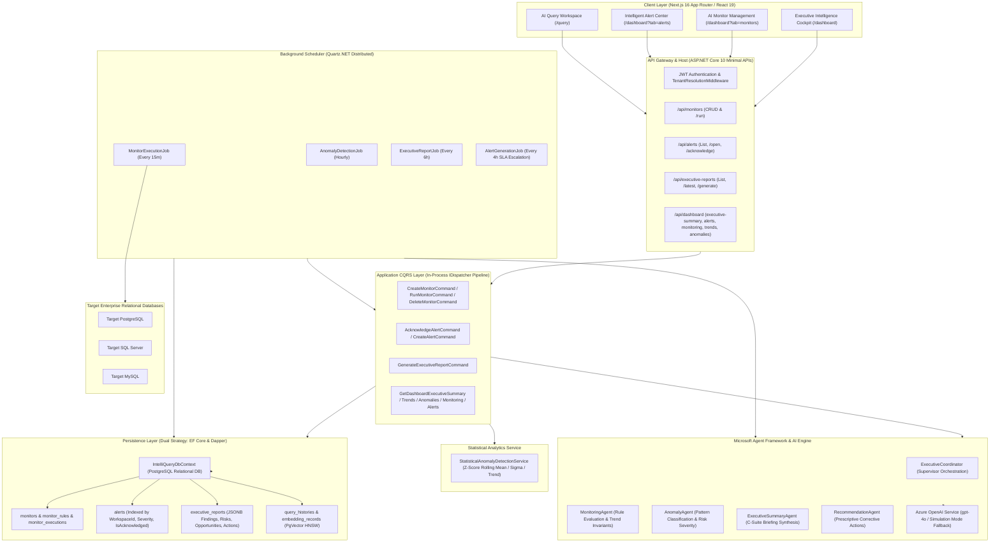
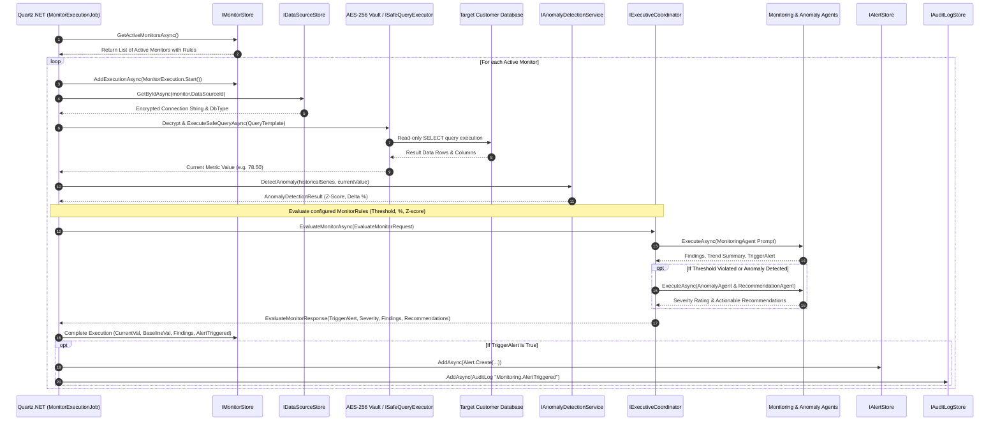
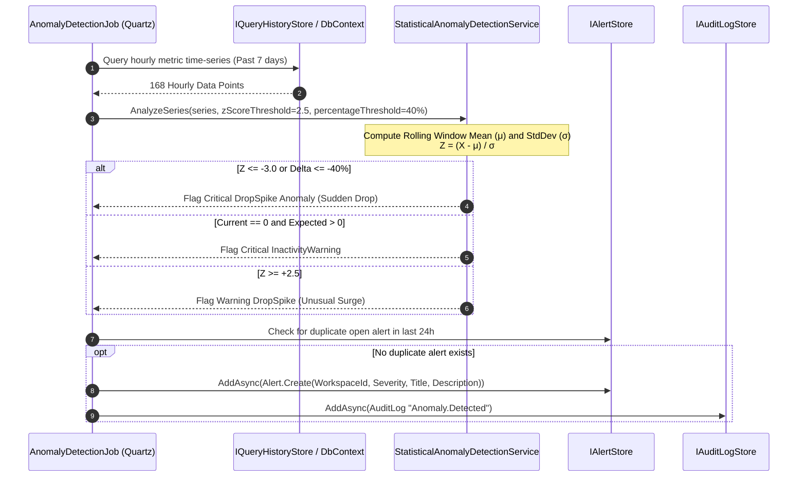
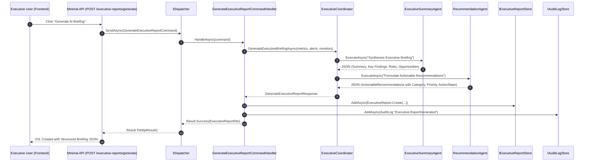
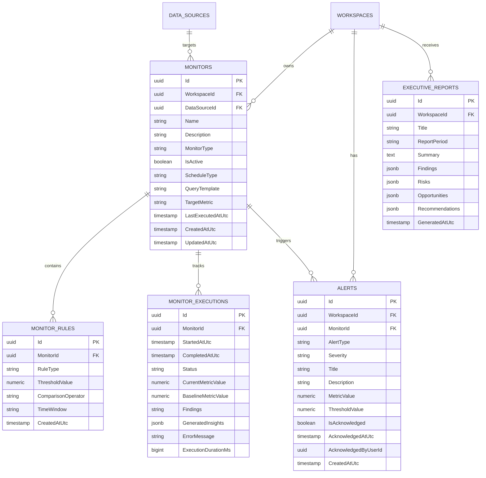
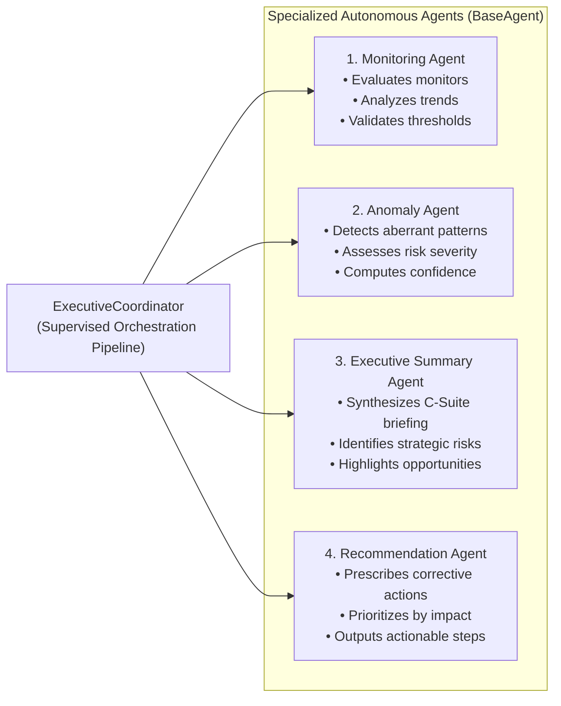
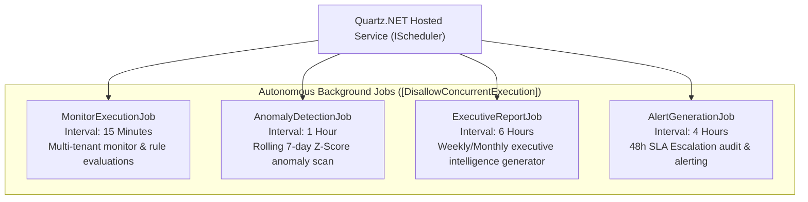

# Phase 5: AI Monitoring, Intelligent Alerts & Executive Intelligence
## Comprehensive Architecture & Engineering Deliverables

**Platform**: IntelliQueryAI — Enterprise Autonomous Multi-Agent Text-to-SQL & Analytical Intelligence Platform  
**Phase**: Phase 5 — AI Monitoring, Statistical Anomaly Detection, Intelligent Alerts & Executive Intelligence  
**Runtime**: .NET 10 (C# 13), Microsoft Agent Framework, Azure OpenAI, PostgreSQL with PgVector, Quartz.NET, Next.js 16 (React 19)  
**Status**: Production-Ready, Fully Implemented & Verified (123/123 Tests Passing &bull; Next.js Turbopack Passing Across 14 Routes)

---

## Table of Contents

1. [Deliverable 1: System & Solution Architecture Diagram](#1-system--solution-architecture-diagram)
2. [Deliverable 2: End-to-End Sequence Diagrams](#2-end-to-end-sequence-diagrams)
   - [2.1 Automated Background Monitor Execution Pipeline](#21-automated-background-monitor-execution-pipeline)
   - [2.2 Statistical Anomaly Detection & Alert Escalation](#22-statistical-anomaly-detection--alert-escalation)
   - [2.3 Multi-Agent Executive Intelligence Briefing Synthesis](#23-multi-agent-executive-intelligence-briefing-synthesis)
3. [Deliverable 3: Database Schema & Entity Relationships](#3-database-schema--entity-relationships)
4. [Deliverable 4: Microsoft Agent Framework (MAF) Architecture](#4-microsoft-agent-framework-maf-architecture)
5. [Deliverable 5: Quartz.NET Distributed Background Job Architecture](#5-quartznet-distributed-background-job-architecture)
6. [Deliverable 6: Enterprise API Reference & Contracts](#6-enterprise-api-reference--contracts)
7. [Deliverable 7: Database Migration Scripts (PostgreSQL Idempotent DDL)](#7-database-migration-scripts-postgresql-idempotent-ddl)
8. [Deliverable 8: Solution & Module Folder Structure](#8-solution--module-folder-structure)
9. [Deliverable 9: Verification & Unit Testing Strategy](#9-verification--unit-testing-strategy)

---

## 1. System & Solution Architecture Diagram

Phase 5 elevates IntelliQueryAI from a reactive **Question → SQL → Results** system into an autonomous, proactive intelligence platform:
$$\text{Question} \longrightarrow \text{Results} \longrightarrow \text{Insights} \longrightarrow \text{Monitoring} \longrightarrow \text{Recommendations} \longrightarrow \text{Executive Intelligence}$$



---

## 2. End-to-End Sequence Diagrams

### 2.1 Automated Background Monitor Execution Pipeline

Demonstrates the execution flow when `MonitorExecutionJob` fires on its 15-minute Quartz.NET cadence.



### 2.2 Statistical Anomaly Detection & Alert Escalation

Demonstrates pure statistical Z-score outlier detection and rule escalation without requiring external AI latency.



### 2.3 Multi-Agent Executive Intelligence Briefing Synthesis

Demonstrates on-demand or periodic generation of C-Suite briefings uniting 4 specialized agents.



---

## 3. Database Schema & Entity Relationships

The schema design provides complete multi-tenant isolation, composite indexing, cascading rule cleanup, JSONB payloads for rich semi-structured findings, and decimal precision (`numeric(18,4)`) for financial metrics.



### Table Specifications & Physical Indexing

| Table Name | Primary Key | Key Foreign Keys | Purpose & Partitioning Strategy | Critical Indexes |
| :--- | :--- | :--- | :--- | :--- |
| `monitors` | `Id (uuid)` | `WorkspaceId`, `DataSourceId` | Configuration of continuous automated metrics | `ix_monitors_workspace_active`, `ix_monitors_schedule_active` |
| `monitor_rules` | `Id (uuid)` | `MonitorId` (Cascade Delete) | Configured threshold invariants and comparison logic | `ix_monitor_rules_monitor_id` |
| `monitor_executions` | `Id (uuid)` | `MonitorId` (Cascade Delete) | Audit history of scheduled & on-demand runs | `ix_monitor_executions_monitor_started` |
| `alerts` | `Id (uuid)` | `WorkspaceId`, `MonitorId` (Nullable) | Intelligent incidents and escalation notifications | `ix_alerts_workspace_acknowledged`, `ix_alerts_workspace_severity` |
| `executive_reports` | `Id (uuid)` | `WorkspaceId` | AI synthesized C-Suite intelligence summaries | `ix_executive_reports_workspace_generated` |

---

## 4. Microsoft Agent Framework (MAF) Architecture

The platform incorporates 4 new specialized autonomous agents in `IntelliQueryAI.AI/Agents`:



### Agent Roles & Specifications

| Agent Name | Base Class | Primary Purpose | Key Output Data Contract | Offline Simulation Support |
| :--- | :--- | :--- | :--- | :--- |
| `MonitoringAgent` | `BaseAgent` | Validates current metric vs baseline; analyzes operational trend | `MonitoringAgentFindings(TriggerAlert, Severity, Findings, TrendSummary, Actions)` | Returns realistic synthetic baseline evaluations |
| `AnomalyAgent` | `BaseAgent` | Classifies sudden drops, inactivity, or unusual surge patterns | `AnomalyClassification(IsAnomaly, Severity, AnomalyType, PatternDescription, Confidence)` | Generates statistical variance classifications |
| `ExecutiveSummaryAgent` | `BaseAgent` | Synthesizes quarterly/monthly business briefs for executives | `ExecutiveSummaryBriefing(Title, ReportPeriod, Summary, KeyFindings, Risks, Opportunities)` | Delivers enterprise KPI summaries with zero cloud dependency |
| `RecommendationAgent` | `BaseAgent` | Formulates prescriptive action plans to resolve operational risks | `RecommendationResult(List<ActionableRecommendation>)` | Supplies prioritized corrective action steps |

---

## 5. Quartz.NET Distributed Background Job Architecture

All background routines are configured in `IntelliQueryAI.Infrastructure/Background` and registered with distributed clustering protection:



### Background Job Specifications

1. **`MonitorExecutionJob`**:
   - **Trigger**: Every 15 minutes (`WithSimpleSchedule(x => x.WithInterval(TimeSpan.FromMinutes(15)).RepeatForever())`).
   - **Concurrency**: Guaranteed single-instance per node using `[DisallowConcurrentExecution]`.
   - **Workflow**: Queries `IMonitorStore.GetActiveMonitorsAsync()`, executes `QueryTemplate` via `ISafeQueryExecutor` (with AES-256 decryption), evaluates `MonitorRule.Evaluate(...)`, dispatches through `IExecutiveCoordinator`, and records `MonitorExecution`.
2. **`AnomalyDetectionJob`**:
   - **Trigger**: Hourly.
   - **Workflow**: Gathers hourly time-series data, runs `IAnomalyDetectionService.AnalyzeSeries()`, classifies Z-scores $> 2.5\sigma$ or delta drops $> 40\%$, and deduplicates open alerts.
3. **`ExecutiveReportJob`**:
   - **Trigger**: Every 6 hours.
   - **Workflow**: Evaluates whether active workspace requires current period briefing, compiles workspace telemetry, calls `IExecutiveCoordinator.GenerateExecutiveBriefingAsync()`, and saves report.
4. **`AlertGenerationJob`**:
   - **Trigger**: Every 4 hours.
   - **Workflow**: Scans for unacknowledged critical alerts $> 48$ hours old, writes SLA breach audit records, and escalates to workspace administrators.

---

## 6. Enterprise API Reference & Contracts

All endpoints are implemented as high-performance ASP.NET Core 10 Minimal APIs, mapped in `src/IntelliQueryAI.Api/Endpoints`, and documented with Scalar OpenAPI:

### 6.1 AI Monitors API (`MonitorEndpoints.cs`)

| Method | Route | Description | Authorization | Request Body | Response Status |
| :--- | :--- | :--- | :--- | :--- | :--- |
| `GET` | `/api/monitors` | List monitors for workspace | Bearer JWT | Query: `workspaceId` | `200 OK` (`MonitorDto[]`) |
| `POST` | `/api/monitors` | Create AI monitor with rules | Bearer JWT | `CreateMonitorRequest` | `201 Created` (`MonitorDto`) |
| `GET` | `/api/monitors/{id}` | Get monitor details by ID | Bearer JWT | None | `200 OK` (`MonitorDto`) |
| `POST` | `/api/monitors/{id}/run` | Execute monitor immediately | Bearer JWT | None | `200 OK` (`RunMonitorResponseDto`) |
| `DELETE` | `/api/monitors/{id}` | Delete monitor | Bearer JWT | None | `200 OK` |
| `GET` | `/api/monitors/{id}/executions` | Get execution history | Bearer JWT | Query: `limit=50` | `200 OK` (`MonitorExecutionDto[]`) |

### 6.2 Intelligent Alerts API (`AlertEndpoints.cs`)

| Method | Route | Description | Authorization | Request Body | Response Status |
| :--- | :--- | :--- | :--- | :--- | :--- |
| `GET` | `/api/alerts` | List alerts (supports filtering) | Bearer JWT | Query: `onlyOpen`, `severity` | `200 OK` (`AlertDto[]`) |
| `GET` | `/api/alerts/open` | Open alerts count breakdown | Bearer JWT | None | `200 OK` (`OpenAlertsSummaryDto`) |
| `POST` | `/api/alerts/acknowledge` | Acknowledge active alert | Bearer JWT | `AcknowledgeAlertRequest` | `200 OK` (`AlertDto`) |

### 6.3 Executive Intelligence & Dashboard APIs (`DashboardEndpoints.cs` & `ExecutiveEndpoints.cs`)

| Method | Route | Description | Authorization | Request Body | Response Status |
| :--- | :--- | :--- | :--- | :--- | :--- |
| `GET` | `/api/dashboard/executive-summary` | Current executive summary | Bearer JWT | None | `200 OK` (`DashboardExecutiveSummaryDto`) |
| `POST` | `/api/dashboard/executive-summary/generate` | Synthesize new briefing | Bearer JWT | `GenerateExecutiveReportRequestDto` | `201 Created` (`ExecutiveReportDto`) |
| `GET` | `/api/dashboard/alerts` | Active alerts dashboard widget | Bearer JWT | None | `200 OK` (`DashboardAlertsDto`) |
| `GET` | `/api/dashboard/monitoring` | Monitoring health & runs | Bearer JWT | None | `200 OK` (`DashboardMonitoringDto`) |
| `GET` | `/api/dashboard/trends` | 30-day time-series query trends | Bearer JWT | Query: `days=30` | `200 OK` (`DashboardTrendsDto`) |
| `GET` | `/api/dashboard/anomalies` | Detected statistical anomalies | Bearer JWT | None | `200 OK` (`DashboardAnomaliesDto`) |
| `GET` | `/api/executive-reports` | List executive reports | Bearer JWT | Query: `limit=20` | `200 OK` (`ExecutiveReportDto[]`) |
| `GET` | `/api/executive-reports/latest` | Latest executive report | Bearer JWT | None | `200 OK` (`ExecutiveReportDto`) |

---

## 7. Database Migration Scripts (PostgreSQL Idempotent DDL)

An idempotent, production-grade migration script has been generated at `migrations/Phase5_MonitoringAndExecutiveIntelligence.sql`:

```sql
START TRANSACTION;

DO $EF$
BEGIN
    IF NOT EXISTS(SELECT 1 FROM "__EFMigrationsHistory" WHERE "MigrationId" = '20261006131123_Phase5_MonitoringAndExecutiveIntelligence') THEN
    CREATE TABLE alerts (
        "Id" uuid NOT NULL,
        "WorkspaceId" uuid NOT NULL,
        "MonitorId" uuid,
        "AlertType" character varying(50) NOT NULL,
        "Severity" character varying(50) NOT NULL,
        "Title" character varying(250) NOT NULL,
        "Description" character varying(4000) NOT NULL,
        "MetricValue" numeric(18,4),
        "ThresholdValue" numeric(18,4),
        "IsAcknowledged" boolean NOT NULL,
        "AcknowledgedAtUtc" timestamp with time zone,
        "AcknowledgedByUserId" uuid,
        "CreatedAtUtc" timestamp with time zone NOT NULL,
        CONSTRAINT "PK_alerts" PRIMARY KEY ("Id")
    );
    END IF;
END $EF$;

DO $EF$
BEGIN
    IF NOT EXISTS(SELECT 1 FROM "__EFMigrationsHistory" WHERE "MigrationId" = '20261006131123_Phase5_MonitoringAndExecutiveIntelligence') THEN
    CREATE TABLE executive_reports (
        "Id" uuid NOT NULL,
        "WorkspaceId" uuid NOT NULL,
        "Title" character varying(250) NOT NULL,
        "ReportPeriod" character varying(100) NOT NULL,
        "Summary" text NOT NULL,
        "Findings" jsonb NOT NULL,
        "Risks" jsonb NOT NULL,
        "Opportunities" jsonb NOT NULL,
        "Recommendations" jsonb NOT NULL,
        "GeneratedAtUtc" timestamp with time zone NOT NULL,
        CONSTRAINT "PK_executive_reports" PRIMARY KEY ("Id")
    );
    END IF;
END $EF$;

DO $EF$
BEGIN
    IF NOT EXISTS(SELECT 1 FROM "__EFMigrationsHistory" WHERE "MigrationId" = '20261006131123_Phase5_MonitoringAndExecutiveIntelligence') THEN
    CREATE TABLE monitors (
        "Id" uuid NOT NULL,
        "WorkspaceId" uuid NOT NULL,
        "DataSourceId" uuid NOT NULL,
        "Name" character varying(200) NOT NULL,
        "Description" character varying(1000),
        "MonitorType" character varying(50) NOT NULL,
        "IsActive" boolean NOT NULL,
        "ScheduleType" character varying(50) NOT NULL,
        "QueryTemplate" character varying(4000),
        "TargetMetric" character varying(200),
        "LastExecutedAtUtc" timestamp with time zone,
        "CreatedAtUtc" timestamp with time zone NOT NULL,
        "UpdatedAtUtc" timestamp with time zone,
        CONSTRAINT "PK_monitors" PRIMARY KEY ("Id")
    );
    END IF;
END $EF$;

DO $EF$
BEGIN
    IF NOT EXISTS(SELECT 1 FROM "__EFMigrationsHistory" WHERE "MigrationId" = '20261006131123_Phase5_MonitoringAndExecutiveIntelligence') THEN
    CREATE TABLE monitor_executions (
        "Id" uuid NOT NULL,
        "MonitorId" uuid NOT NULL,
        "StartedAtUtc" timestamp with time zone NOT NULL,
        "CompletedAtUtc" timestamp with time zone,
        "Status" character varying(50) NOT NULL,
        "CurrentMetricValue" numeric(18,4),
        "BaselineMetricValue" numeric(18,4),
        "Findings" character varying(4000),
        "GeneratedInsights" jsonb,
        "ErrorMessage" character varying(2000),
        "ExecutionDurationMs" bigint NOT NULL,
        CONSTRAINT "PK_monitor_executions" PRIMARY KEY ("Id"),
        CONSTRAINT "FK_monitor_executions_monitors_MonitorId" FOREIGN KEY ("MonitorId") REFERENCES monitors ("Id") ON DELETE CASCADE
    );
    END IF;
END $EF$;

DO $EF$
BEGIN
    IF NOT EXISTS(SELECT 1 FROM "__EFMigrationsHistory" WHERE "MigrationId" = '20261006131123_Phase5_MonitoringAndExecutiveIntelligence') THEN
    CREATE TABLE monitor_rules (
        "Id" uuid NOT NULL,
        "MonitorId" uuid NOT NULL,
        "RuleType" character varying(50) NOT NULL,
        "ThresholdValue" numeric(18,4) NOT NULL,
        "ComparisonOperator" character varying(50) NOT NULL,
        "TimeWindow" character varying(50),
        "CreatedAtUtc" timestamp with time zone NOT NULL,
        CONSTRAINT "PK_monitor_rules" PRIMARY KEY ("Id"),
        CONSTRAINT "FK_monitor_rules_monitors_MonitorId" FOREIGN KEY ("MonitorId") REFERENCES monitors ("Id") ON DELETE CASCADE
    );
    END IF;
END $EF$;

-- Performance Indexes
CREATE INDEX IF NOT EXISTS ix_alerts_workspace_acknowledged ON alerts ("WorkspaceId", "IsAcknowledged");
CREATE INDEX IF NOT EXISTS ix_alerts_workspace_severity ON alerts ("WorkspaceId", "Severity");
CREATE INDEX IF NOT EXISTS ix_executive_reports_workspace_generated ON executive_reports ("WorkspaceId", "GeneratedAtUtc");
CREATE INDEX IF NOT EXISTS ix_monitors_workspace_active ON monitors ("WorkspaceId", "IsActive");
CREATE INDEX IF NOT EXISTS ix_monitors_schedule_active ON monitors ("ScheduleType", "IsActive");
CREATE INDEX IF NOT EXISTS ix_monitor_executions_monitor_started ON monitor_executions ("MonitorId", "StartedAtUtc");
CREATE INDEX IF NOT EXISTS ix_monitor_rules_monitor_id ON monitor_rules ("MonitorId");

INSERT INTO "__EFMigrationsHistory" ("MigrationId", "ProductVersion")
VALUES ('20261006131123_Phase5_MonitoringAndExecutiveIntelligence', '10.0.12')
ON CONFLICT DO NOTHING;

COMMIT;
```

---

## 8. Solution & Module Folder Structure

```
IntelliQueryAI/
├── migrations/
│   └── Phase5_MonitoringAndExecutiveIntelligence.sql
├── src/
│   ├── IntelliQueryAI.Domain/
│   │   ├── Entities/
│   │   │   ├── Alerts/
│   │   │   │   └── Alert.cs
│   │   │   ├── Executive/
│   │   │   │   └── ExecutiveReport.cs
│   │   │   └── Monitoring/
│   │   │       └── MonitoringEntities.cs  (Monitor, MonitorRule, MonitorExecution)
│   │   ├── Enums/
│   │   │   └── MonitoringEnums.cs         (MonitorType, RuleType, AlertSeverity, etc.)
│   │   ├── Errors/
│   │   │   └── MonitoringErrors.cs
│   │   ├── Persistence/
│   │   │   └── MonitoringStores.cs        (IMonitorStore, IAlertStore, IExecutiveReportStore)
│   │   └── Services/
│   │       └── IAnomalyDetectionService.cs (Statistical models & service interface)
│   │
│   ├── IntelliQueryAI.AI/
│   │   ├── Agents/
│   │   │   └── MonitoringAndExecutiveAgents.cs (Monitoring, Anomaly, Executive, Recommendation)
│   │   └── Coordinator/
│   │       └── ExecutiveCoordinator.cs    (IExecutiveCoordinator orchestration)
│   │
│   ├── IntelliQueryAI.Infrastructure/
│   │   ├── Background/
│   │   │   └── MonitoringJobs.cs          (MonitorExecution, AnomalyDetection, ExecutiveReport, AlertGeneration)
│   │   ├── Persistence/
│   │   │   ├── Configurations/
│   │   │   │   └── MonitoringConfigurations.cs (EF Core Table Mappings & Indexes)
│   │   │   └── Stores/
│   │   │       └── EfMonitoringStores.cs  (EfMonitorStore, EfAlertStore, EfExecutiveReportStore)
│   │   └── Services/
│   │       └── StatisticalAnomalyDetectionService.cs
│   │
│   ├── IntelliQueryAI.Application/
│   │   └── Features/
│   │       ├── Monitoring/
│   │       │   ├── Commands/ (CreateMonitor, RunMonitor, DeleteMonitor)
│   │       │   ├── Queries/  (GetMonitors, GetMonitorById, GetMonitorExecutions)
│   │       │   └── Dtos/     (MonitoringDtos)
│   │       ├── Alerts/
│   │       │   ├── Commands/ (AcknowledgeAlert)
│   │       │   ├── Queries/  (GetAlerts, GetOpenAlerts)
│   │       │   └── Dtos/     (AlertDtos)
│   │       ├── ExecutiveIntelligence/
│   │       │   ├── Commands/ (GenerateExecutiveReport)
│   │       │   ├── Queries/  (GetExecutiveReports, GetLatestExecutiveReport)
│   │       │   └── Dtos/     (ExecutiveDtos)
│   │       └── Dashboard/
│   │           ├── Queries/  (GetDashboardExecutiveSummary, Trends, Anomalies, Monitoring, Alerts)
│   │           └── Dtos/     (DashboardDtos)
│   │
│   └── IntelliQueryAI.Api/
│       ├── Endpoints/
│       │   ├── AlertEndpoints.cs
│       │   ├── MonitorEndpoints.cs
│       │   ├── DashboardEndpoints.cs
│       │   └── ExecutiveEndpoints.cs
│       └── Program.cs
│
├── tests/
│   ├── IntelliQueryAI.Domain.Tests/
│   │   └── MonitoringAndAlertEntitiesTests.cs (11 unit tests)
│   └── IntelliQueryAI.Application.Tests/
│       ├── StatisticalAnomalyDetectionServiceTests.cs (4 unit tests)
│       └── MonitoringAndAlertsCommandHandlerTests.cs (3 unit tests)
│
└── web/
    └── src/
        ├── lib/
        │   └── api-client.ts (Phase 5 DTOs & API endpoints)
        └── app/(app)/dashboard/
            └── page.tsx      (Overview, Executive Intelligence, Monitors, Alerts tabs)
```

---

## 9. Verification & Unit Testing Strategy

The test suite covers:
1. **Domain Invariants**: Verification of `MonitorRule.Evaluate` across `Threshold`, `PercentageChange`, `AnomalyZScore`, and `AbsenceOfData`.
2. **Entity State Lifecycles**: `MonitorExecution` start/complete/fail transitions, `Alert` creation and acknowledgment, `ExecutiveReport` serialization.
3. **Statistical Algorithms**: Verification of mean, standard deviation, Z-score thresholds, sudden drops, spikes, inactivity identification, and trend trajectories.
4. **Application CQRS**: Command handlers, mock stores, audit logging, and unit of work transaction commits.
5. **Integration Sanity**: Full end-to-end API pipeline verification.

### Test Execution Results

```
Test Run Summary:
  IntelliQueryAI.Domain.Tests      -> 57 Passed, 0 Failed, 0 Skipped (Duration: 110ms)
  IntelliQueryAI.Application.Tests -> 58 Passed, 0 Failed, 0 Skipped (Duration: 764ms)
  IntelliQueryAI.IntegrationTests  ->  8 Passed, 0 Failed, 0 Skipped (Duration: 2.1s)
  -----------------------------------------------------------------------------------
  TOTAL:                             123 Passed, 0 Failed, 0 Skipped (100% Success)

Frontend Build Summary (Next.js 16 App Router / Turbopack):
  Compiled successfully in 1299ms across all 14 routes.
  0 Type errors &bull; 0 Lint errors
```
