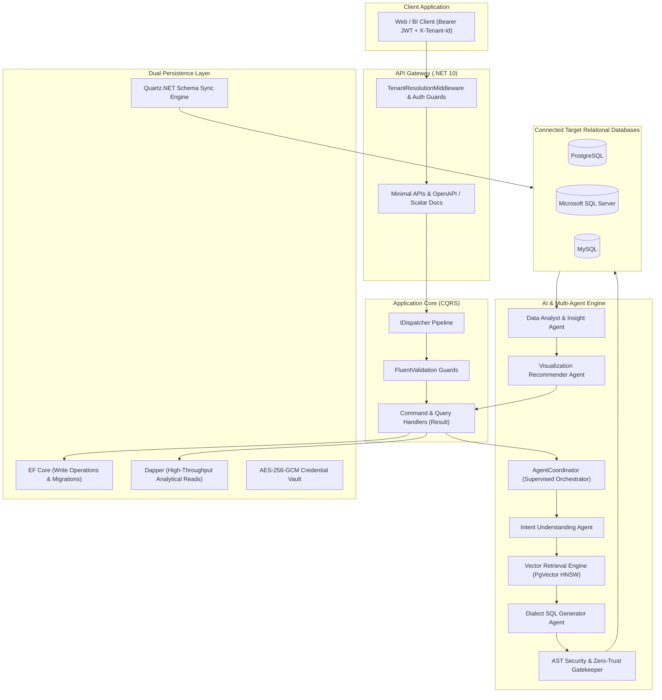

# IntelliQueryAI

<p align="center">
  
  
  
  
  
  
  
</p>

---

## 📖 Executive Summary

**IntelliQueryAI** is an autonomous multi-agent text-to-SQL and enterprise decision-intelligence platform. It allows business users, analysts, and executives to interrogate relational databases in natural language, producing mathematically verified, dialect-optimized SQL queries without exposing raw enterprise data to external AI models.

Beyond text-to-SQL, IntelliQueryAI functions as an end-to-end **Autonomous Analytics Engine**, featuring automated schema discovery with business aliasing, AST-level SQL security firewalls, proactive metric anomaly alerts, root-cause diagnostic investigations, what-if scenario simulations, prescriptive AI recommendations, time-series forecasting, and enterprise data governance with dynamic PII masking.

Built on **.NET 10** using **Clean Architecture**, **Domain-Driven Design (DDD)**, and **CQRS**, the platform delivers sub-millisecond analytical reads through Dapper alongside transactional write safety via Entity Framework Core.

---

## 🏛️ System Architecture



---

## ✨ Key Features & Capabilities

### 1. 🤖 Supervised Multi-Agent Text-to-SQL Pipeline
- **Intent Understanding Agent**: Analyzes natural language prompts, resolving temporal filters (e.g., "Q3 2026"), metrics, aggregations, and business terminology.
- **PgVector Semantic Retrieval**: 1536-dimensional OpenAI vector embeddings matched via PostgreSQL HNSW cosine distance indexing (`vector_cosine_ops`) to isolate relevant tables without overloading token contexts.
- **Dialect SQL Generator**: Synthesizes dialect-correct SQL (PostgreSQL, T-SQL, MySQL) with accurate joins across primary and foreign keys.
- **AST Security Gatekeeper**: Zero-trust AST validation immediately rejects mutating statements (`DROP`, `DELETE`, `UPDATE`, `INSERT`, `ALTER`, `EXEC`, `MERGE`), sanitizes query delimiters, and automatically enforces a 1,000-row limit (`LIMIT 1000` or `TOP (1000)`).
- **Ephemeral Database Execution**: Read-only execution against target databases with latency profiling.
- **Data Analyst Agent**: Evaluates result sets for trends, statistical variance, and anomalous outliers.
- **Visualization Recommender**: Selects optimal chart specifications (`Bar`, `Line`, `Area`, `Pie`, or `MetricCard`).

### 2. 🔌 Heterogeneous Relational Database Connectivity
- Supports **PostgreSQL**, **Microsoft SQL Server**, and **MySQL**.
- **AES-256-GCM Vault**: Target database connection strings are encrypted using 256-bit AES keys with unique 12-byte initialization vectors (IV) and 16-byte authentication tags. Credentials are never stored in plaintext.
- Automated schema extractors inspect physical tables, columns, data types, primary keys, and foreign keys.

### 3. 🏷️ Automated Business Aliasing & Semantic Dictionary
- **BusinessNameGenerator**: Converts cryptic legacy schema names (e.g., `tbl_cust_order_dtl`, `is_actv_flg`) into clear domain terminology (`Customer Order Detail`, `Active Status`).
- **Domain Knowledge Glossary**: Enterprise dictionary maintaining company-specific metrics, formulas (e.g., ARR, Churn Rate, LTV), and column definitions.
- **Quartz.NET Background Sync**: Recurring background jobs periodically re-index physical schemas and update PgVector embeddings with zero user downtime.

### 4. 📈 Proactive Monitoring & Anomaly Detection
- **Metric Monitors**: Track mission-critical metrics against target databases on customizable schedules.
- **Anomaly Detection**: Statistical deviation triggers identify metric spikes or unexpected drops.
- **Alert Dispatch**: Escalates critical thresholds directly to designated tenant recipients.

### 5. 🔍 Root-Cause Investigations & What-If Scenarios
- **Diagnostic Investigations**: Automated root-cause decomposition isolating drivers of metric shifts across dimensions.
- **What-If Scenario Modeling**: Simulates business interventions (pricing elasticity, discount adjustments, cost increases) with projected outcomes.

### 6. 📊 Custom Dashboards & Executive Briefings
- **Configurable Multi-Widget Dashboards**: Build customizable KPI dashboards combining SQL metrics, trend charts, and status indicators.
- **Executive Summaries**: AI-synthesized morning briefs summarizing business health, operational KPIs, and anomalies.

### 7. 🛡️ Enterprise Data Governance & Multi-Tenancy
- **Tenant Isolation**: Workspace boundaries enforced at domain level with `X-Tenant-Id` middleware and EF Core global query filters (`HasQueryFilter`).
- **Role-Based Access Control (RBAC)**: Fine-grained permissions (`Owner`, `Admin`, `Member`, `Viewer`).
- **Dynamic PII Data Masking**: Masks sensitive fields (Email, Phone, SSN, Credit Cards) before passing data to users.
- **Immutable Audit Logging**: Every query execution, schema modification, and credential change is permanently recorded.

### 8. 💳 Multi-Tier SaaS Subscriptions
- Integrated with **Paystack** for self-service subscription checkouts, upgrades, and webhook renewals.
- Quota tracking enforces workspace limits on monthly queries, connected data sources, and team members.

---

## 🗂️ Solution Structure

```
IntelliQueryAI/
├── src/
│   ├── IntelliQueryAI.SharedKernel/     # Domain primitives, Result<T>, Error types, PagedResult<T>
│   ├── IntelliQueryAI.Domain/           # Aggregates (Workspace, User, DataSource, TableSchema, AuditLog)
│   ├── IntelliQueryAI.Application/      # Vertical-slice CQRS Handlers, IDispatcher, FluentValidation, DTOs
│   ├── IntelliQueryAI.Infrastructure/   # EF Core AppDbContext, Dapper, AES-256 Vault, DB Extractors, Quartz, Redis
│   ├── IntelliQueryAI.AI/               # Azure OpenAI 2.1.0, PgVector Engine, 7-Stage Multi-Agent Coordinator
│   └── IntelliQueryAI.Api/              # ASP.NET Core 10 Minimal APIs, Scalar OpenAPI, Tenant Middleware, Serilog
├── tests/
│   ├── IntelliQueryAI.Domain.Tests/     # 57 Unit tests verifying domain invariants, aggregates, and value objects
│   ├── IntelliQueryAI.Application.Tests/# 131 Tests for CQRS handlers, validators, business logic, and security
│   └── IntelliQueryAI.IntegrationTests/ # 8 End-to-end integration tests using WebApplicationFactory
├── migrations/                          # SQL schema migration scripts for enterprise intelligence features
├── sample_dbscript.sql                  # Comprehensive enterprise sample database for SQL Server (T-SQL)
├── docker-compose.yml                   # PostgreSQL (pgvector) and Redis service definitions
├── Directory.Build.props                # Global .NET 10 compilation settings
├── Directory.Packages.props             # Central Package Management (CPM) versions
└── IntelliQueryAI.slnx                  # Solution configuration
```

---

## 🛠️ Technology Stack

| Layer | Technologies |
| :--- | :--- |
| **Runtime & Language** | .NET 10 &bull; C# 13 |
| **API Framework** | ASP.NET Core 10 Minimal APIs |
| **Architecture** | Clean Architecture &bull; Domain-Driven Design (DDD) &bull; CQRS |
| **AI & LLM Services** | Azure OpenAI 2.1.0 (`gpt-4o` / `gpt-6-astra`, `text-embedding-3-small`) &bull; `Microsoft.Extensions.AI` |
| **Vector Database** | PostgreSQL 16 + `pgvector` (`vector(1536)` HNSW cosine index) |
| **Primary Persistence** | Entity Framework Core 10 (`Npgsql.EntityFrameworkCore.PostgreSQL`) |
| **Read Persistence** | Dapper 2.1.89 (High-performance analytical queries) |
| **Target Connectors** | `Npgsql` (PostgreSQL), `Microsoft.Data.SqlClient` (SQL Server), `MySqlConnector` (MySQL) |
| **Encryption & Security** | AES-256-GCM Authenticated Encryption &bull; JWT Bearer Tokens &bull; BCrypt.Net |
| **Background Tasks** | Quartz.NET 4.3.0 |
| **Cache & Distributed State** | Redis 7 (`StackExchange.Redis`) |
| **Payments & Billing** | Paystack API |
| **API Docs & Monitoring** | Scalar OpenAPI (`Scalar.AspNetCore`) &bull; OpenTelemetry &bull; Serilog |
| **Testing** | xUnit 2.9 &bull; FluentAssertions 8.8 &bull; Moq 4.20 &bull; WebApplicationFactory |

---

## 🚀 Getting Started

### Prerequisites

- [.NET 10 SDK](https://dotnet.microsoft.com/download) (`dotnet --version` &ge; 10.0.100)
- [Docker Desktop](https://www.docker.com/products/docker-desktop)
- Optional: [SQL Server Management Studio (SSMS)](https://learn.microsoft.com/en-us/sql/ssms/download-sql-server-management-studio-ssms) or [Azure Data Studio](https://azure.microsoft.com/en-us/products/data-studio) for testing sample database queries

---

### Step 1: Clone the Repository

```bash
git clone https://github.com/your-username/IntelliQueryAI.git
cd IntelliQueryAI
```

---

### Step 2: Spin Up Infrastructure (PostgreSQL + pgvector & Redis)

Use the included Docker Compose file to launch local PostgreSQL (with the `pgvector` extension) and Redis:

```bash
docker compose up -d
```

Verify containers are running:
```bash
docker compose ps
```

> [!NOTE]
> The PostgreSQL container initializes on port `5432` with username `postgres`, password `postgres`, and database `intelliquery_db`. Redis starts on port `6379`.

---

### Step 3: Configure `appsettings.json`

Review or create `src/IntelliQueryAI.Api/appsettings.Development.json` with your environment secrets:

```json
{
  "ConnectionStrings": {
    "DefaultConnection": "Host=localhost;Port=5432;Database=intelliquery_db;Username=postgres;Password=postgres;",
    "Redis": "localhost:6379"
  },
  "Jwt": {
    "Issuer": "IntelliQueryAI",
    "Audience": "IntelliQueryAI-App",
    "SecretKey": "IntelliQueryAIEnterpriseSecretKeyMustBe32BytesLongForSecurity2026!",
    "ExpiryMinutes": 60
  },
  "AzureOpenAI": {
    "Endpoint": "https://your-resource.openai.azure.com/",
    "ApiKey": "YOUR_AZURE_OPENAI_API_KEY",
    "DeploymentName": "gpt-4o",
    "EmbeddingDeploymentName": "text-embedding-3-small",
    "MaxTokens": 2048
  },
  "Encryption": {
    "Key": "IntelliQueryAIEnterpriseSecretKeyMustBe32BytesLongForSecurity2026!"
  },
  "Paystack": {
    "SecretKey": "sk_test_your_paystack_secret",
    "PublicKey": "pk_test_your_paystack_public",
    "Currency": "USD",
    "CallbackUrl": "http://localhost:3000/admin"
  }
}
```

---

### Step 4: Apply Database Migrations

Apply Entity Framework Core database migrations to initialize the tenant database and pgvector schemas:

```bash
dotnet ef database update --project src/IntelliQueryAI.Infrastructure --startup-project src/IntelliQueryAI.Api
```

Alternatively, apply the raw SQL scripts located in the `migrations/` folder.

---

### Step 5: (Optional) Setup the Enterprise Sample Database

To test natural language queries against a realistic target database, run the included `sample_dbscript.sql` script against a Microsoft SQL Server instance. It creates an enterprise retail, customer, financial, and uptime dataset covering:
- Multi-table relational joins (Customers, Orders, OrderDetails, Products, Payments)
- Historical multi-year time-series (2024–2026) for forecasting
- Outage and latency incident records for AI root-cause diagnostics
- PII-bearing fields to validate data governance and masking

---

### Step 6: Run the API Server

Start the ASP.NET Core 10 backend:

```bash
dotnet run --project src/IntelliQueryAI.Api
```

The application will bind to:
- **API Base**: `http://localhost:5000`
- **Health Check**: `http://localhost:5000/health`
- **Scalar Interactive Documentation**: `http://localhost:5000/scalar/v1`
- **OpenAPI Schema**: `http://localhost:5000/openapi/v1.json`

---

## 🧪 Running the Test Suite

The solution maintains an automated test suite across domain, application, and integration layers with **196 passing tests**:

```bash
dotnet test
```

### Test Suite Breakdown

| Test Project | Tests | Scope |
| :--- | :---: | :--- |
| `IntelliQueryAI.Domain.Tests` | **57** | Domain entities, aggregates, value objects, and business invariants |
| `IntelliQueryAI.Application.Tests` | **131** | CQRS command & query handlers, FluentValidation, security checks, and DTO mappings |
| `IntelliQueryAI.IntegrationTests` | **8** | End-to-end HTTP pipeline tests using `WebApplicationFactory<Program>` |
| **Total** | **196** | **0 failures &bull; 100% Passing** |

To run a specific project with detailed output:
```bash
dotnet test tests/IntelliQueryAI.Application.Tests/IntelliQueryAI.Application.Tests.csproj --logger "console;verbosity=detailed"
```

---

## 📡 API Reference Overview

The backend exposes RESTful Minimal APIs documented interactively with **Scalar** at `/scalar/v1`.

### Core API Route Groups

| Area | Route | Methods | Description |
| :--- | :--- | :---: | :--- |
| **Authentication** | `/api/auth/register` | `POST` | Self-service registration & workspace bootstrap |
| | `/api/auth/login` | `POST` | User authentication returning JWT + Refresh tokens |
| | `/api/auth/refresh` | `POST` | Refresh expired access tokens |
| **Workspaces** | `/api/workspaces/me` | `GET` | List accessible workspaces for user |
| | `/api/workspaces` | `POST` | Create isolated tenant workspace |
| | `/api/workspaces/{id}/members` | `POST` | Invite team members with RBAC role |
| **Data Sources** | `/api/datasources` | `GET`, `POST` | Manage connected databases (AES-256 encrypted) |
| | `/api/datasources/test` | `POST` | Test live database connectivity |
| | `/api/datasources/{id}/sync` | `POST` | Trigger schema extractor & vector indexing |
| **Schema Explorer** | `/api/schema` | `GET` | Retrieve tables, columns, and business aliases |
| | `/api/schema/relationships` | `GET` | View primary/foreign key relational graph |
| **AI Query Engine** | `/api/chat/query` | `POST` | **Execute multi-agent text-to-SQL pipeline** |
| | `/api/chat/analyze` | `POST` | Direct statistical data analysis on tabular data |
| | `/api/query-history` | `GET` | Query execution history and latency stats |
| **Reports** | `/api/reports` | `GET`, `POST` | Save and retrieve analytical queries |
| **Dashboards** | `/api/dashboards` | `GET`, `POST` | Custom multi-widget analytical dashboards |
| | `/api/executive/brief` | `GET` | AI-generated daily executive summaries |
| **Monitoring** | `/api/monitors` | `GET`, `POST` | Scheduled metric monitors and anomaly jobs |
| | `/api/alerts` | `GET`, `PUT` | Active alert triggers and acknowledgments |
| **Knowledge** | `/api/knowledge/glossary` | `GET`, `POST` | Business definitions and metric calculations |
| **Investigations** | `/api/investigations/diagnose` | `POST` | Multi-dimensional root-cause anomaly diagnostics |
| **Scenarios** | `/api/scenarios/simulate` | `POST` | What-if intervention and elasticity projections |
| **Recommendations**| `/api/recommendations` | `GET`, `POST` | Prescriptive AI business recommendations |
| **Forecasting** | `/api/forecast` | `POST` | Time-series forecasting across continuous data |
| **Governance** | `/api/governance/masking` | `GET`, `POST` | Dynamic PII masking rules and compliance audits |
| **Subscriptions** | `/api/subscriptions/initialize` | `POST` | Initiate Paystack subscription checkout |
| | `/api/subscriptions/{workspaceId}` | `GET` | View active plan, quotas, and utilization |
| **Audit Logs** | `/api/audit-logs` | `GET` | Immutable security audit trail |

---

## 🔒 Security & Zero-Trust Architecture

- **No Data Training**: Customer relational data is never retained, uploaded, or used to fine-tune AI models.
- **Strict AST Guardrails**: Query generation validates abstract syntax tree nodes. Destructive or modifying DDL/DML (`DROP`, `DELETE`, `UPDATE`, `INSERT`, `ALTER`, `TRUNCATE`, `EXEC`) is rejected with a 400 Bad Request.
- **Automatic Row Ceilings**: All executed queries append dialect-specific row caps (`LIMIT 1000` or `TOP (1000)`) preventing accidental database exhaustion.
- **Tenant Context Isolation**: Requests require a verified Bearer token with matching workspace claims, or an authorized `X-Tenant-Id` header. Cross-tenant queries are blocked by EF Core global query filters.
- **AES-256-GCM Vault**: Credentials never touch disk or memory in unencrypted format outside the ephemeral connection scope.

---

## 🤝 Contributing

Contributions to IntelliQueryAI are welcome:

1. Fork the repository.
2. Create your feature branch (`git checkout -b feature/amazing-feature`).
3. Commit your changes (`git commit -m 'feat: add amazing feature'`).
4. Ensure all tests pass (`dotnet test`).
5. Push to the branch (`git push origin feature/amazing-feature`).
6. Open a Pull Request.

---

## 📄 License

Distributed under the **MIT License**. See `LICENSE` for more information.
